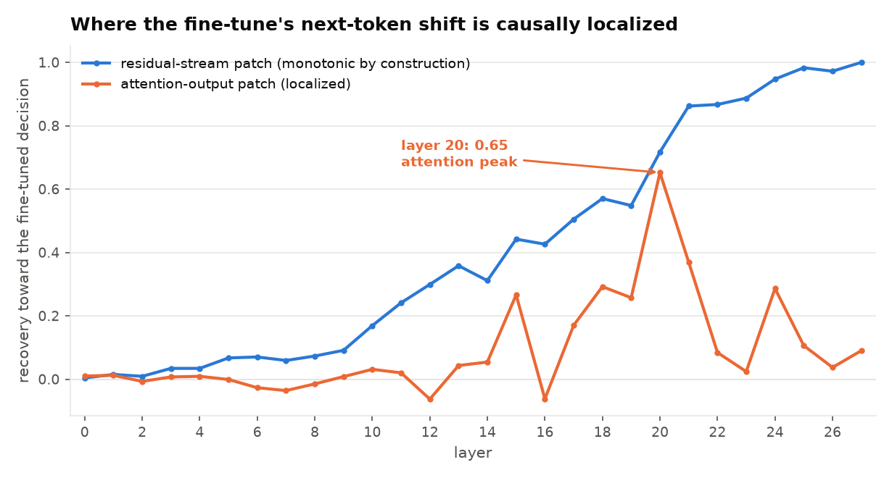
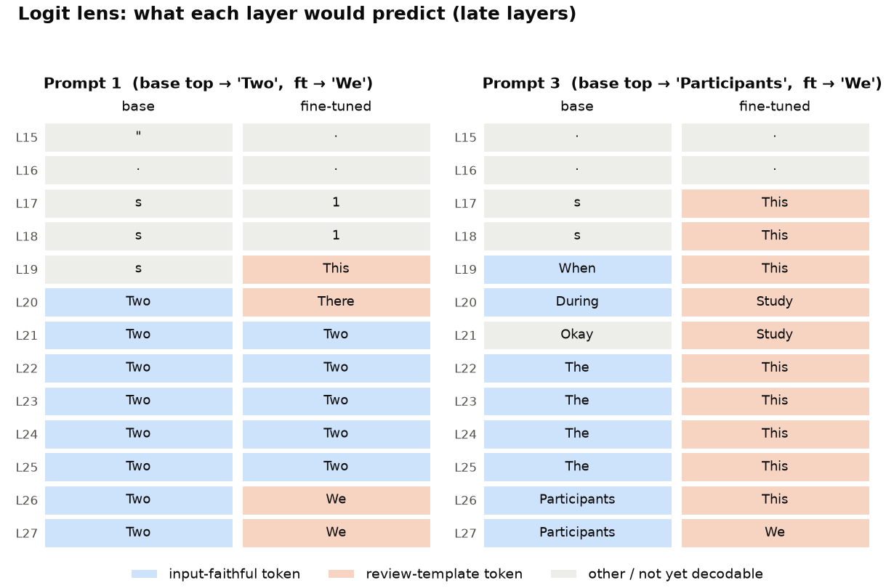

# LucidRT — fine-tune + fast inference for plain-language medical text

Fine-tune a small modern LLM (**Qwen2.5-1.5B-Instruct**) with LoRA to rewrite dense
clinical abstracts into **plain language a patient can understand** — then build an
inference-optimization harness (KV cache, quantization, batching, profiling) and prove
every speedup with measured, apples-to-apples numbers, ending with a same-hardware
benchmark against **vLLM** — and finally an **interpretability pass** that catches the
fine-tune's headline metric lying, localizes *why* inside the network, and then **closes
the loop**: a fix that fails twice, teaches the lesson, and finally makes the mechanism disappear.

> ⚕️ **Not for clinical use.** Educational / portfolio project trained on public,
> de-identified data. Three simplification datasets are compared —
> [`med_paragraph_simplification`](https://huggingface.co/datasets/lighteval/med_paragraph_simplification)
> and [`sci_lay`](https://huggingface.co/datasets/paniniDot/sci_lay) (both traps) and
> [`wiki_auto_asset_turk`](https://huggingface.co/datasets/GEM/wiki_auto_asset_turk) (genuinely plain).
> It simplifies text; it does not give medical advice.

---

## Why this project exists

It covers two halves of shipping a fine-tuned model end to end:

1. **Build & optimize** — fine-tune a current LLM with LoRA, then make inference fast and
   measure every gain one variable at a time: KV caching, quantization, batching, prefill/decode
   profiling, and a same-hardware benchmark against vLLM.
2. **Evaluate & fix** — build the eval and data-screening tooling that caught the fine-tune's
   flattering metric lying, trace the regression to its root cause, and fix it — confirming the
   failure is gone.

The theme throughout: don't just make it work — **optimize each step, measure it against a
baseline, and keep the honest trade-offs** (including the "optimization" that made things
worse — the sharpest example of which is the fine-tune's own headline number).

---

## Headline results

Model **Qwen2.5-1.5B-Instruct**; task: plain-language medical simplification. Training/opt
numbers come from several GPU sessions on mixed hardware, so treat latency as **directional** —
except the vLLM section below, which is a single-machine A100 run.

| Area | Result |
|---|---|
| **Fine-tune (LoRA)** | **+37% ROUGE-L** (0.097 → 0.133); adapter **20.2 MB**, only **0.14%** of params trained (2.18M / 1.54B); loss 1.88 → ~1.55 over 300 steps — **but ⚠️ this ROUGE gain is a Goodhart artifact, not a quality win** (see [Interpretability](#what-did-the-fine-tune-actually-change-an-interpretability-pass)) |
| **KV cache** | **~1.9× faster** than a naive re-encode loop, **bit-identical** output (gap grows with output length) |
| **Prefill vs decode** | decode is **97–99% of runtime** and **~400× more expensive per token** than prefill — the bottleneck is memory-bound |
| **int4-AWQ** | **1.15 GB** (2.7× smaller than fp16's 3.10 GB), **7.7× faster decode than int8** |
| **int8** | half the memory of fp16, but **~7× slower** and slightly lower quality — a **poor trade-off here** |
| **Batching** | **~10× throughput** (11 → 124 tok/s at batch 16) by amortizing the weight load |
| **vLLM (same A100)** | **1.4–3.4× faster** than the hand-built pipeline — the pure engine gap |

**The findings I'd lead with in an interview:**
- The fine-tune's **+37% ROUGE-L was a Goodhart artifact** — it learned the reference *register*
  and hallucinated specifics instead of simplifying (readability **+4.2 grade levels**, fabricated
  numbers **0 → 19**), and I localized the change to a **late-layer attention mechanism (~layer 20)**.
  Catching a flattering metric lying — and proving it three different ways — is the result I'm
  proudest of. Then I **closed the loop across three datasets**: my own "pick a clean dataset" fix
  first *fooled me* (the selection metric was itself Goodharted), and only after fixing that did a
  genuinely-plain dataset stop the model breaking — with the mechanism measurably **gone**.
  (See [Interpretability](#what-did-the-fine-tune-actually-change-an-interpretability-pass).)
- **int4-AWQ dominated int8** — smaller **and** faster at no quality cost; int8's only win was memory.
- **Decode is memory-bound**, which is *why* the KV cache and batching pay off at all. That one
  fact ties the whole systems half together.

Full tables: [`results/benchmarks.md`](results/benchmarks.md).

---

## The vLLM capstone — separating the engine from the hardware

The first time I compared my hand-built pipeline to vLLM, vLLM looked **~12× faster**. That
number was a lie — most of it was *hardware*: my pipeline had been timed on an old T4/TITAN V,
and vLLM on an A100. So I re-ran **both engines on the same A100-40**, same model, same
prompt, same 50 greedy tokens:

| batch | hand-built tok/s | vLLM tok/s | vLLM speedup |
|---:|---:|---:|---:|
| 1  | 44.8   | 153.5  | **3.4×** |
| 8  | 355.2  | 929.5  | **2.6×** |
| 16 | 740.6  | 1503.3 | **2.0×** |
| 32 | 1249.3 | 2174.2 | **1.7×** |
| 64 | 1915.1 | 2767.6 | **1.4×** |

On equal hardware the engine advantage is **1.4–3.4×** — biggest at single-sequence (CUDA
graphs + fused kernels erase per-step overhead my Python loop pays), narrowing as batch grows.

**Why the gap shrinks, and when vLLM would actually pull away:** this benchmark feeds
*uniform-length prompts arriving all at once* — the best case for simple static batching, with
no padding waste and no ragged finishes. vLLM's **continuous batching + PagedAttention** win
*most* under realistic **ragged / variable-length / streaming** load, which this synthetic test
deliberately doesn't stress. Knowing *when* an engine wins — not just that it does — is the
point of the exercise.

---

## What did the fine-tune actually change? (an interpretability pass)

The headline `+37% ROUGE-L` looked like a clean win. It isn't — and catching that is the result
I'd defend hardest.

**The metric was Goodharted.** ROUGE scores n-gram overlap against the reference "plain-language"
answers. But those references are **Cochrane plain-language summaries**, and a diagnostic on the
dataset (n=100) shows they aren't actually simpler than the inputs they summarize:

| text | Flesch–Kincaid grade |
|---|---|
| technical input | 11.7 |
| "plain" reference answer | **13.4** |

The references are *harder* than the inputs — dense with study specifics (years, participant
counts, drug names, risk ratios). So "maximize ROUGE against these references" does **not** mean
"simplify"; it means "write in the Cochrane review register, with specifics." The fine-tune learned
exactly that.

**Behavioral eval (base vs fine-tuned, held-out medical probes):**

| metric | base | fine-tuned |
|---|---|---|
| readability (FK grade) | 7.8 | **12.0**  (+4.2 — *harder*, not simpler) |
| fabricated numbers (figures in the output absent from the input) | **0** | **19** |

The fine-tune invents specifics that were never in the input — study years, participant counts,
drugs, "RR 0.68 95% CI 0.44–1.05". The **base** instruct model is the *more faithful* simplifier
(zero fabrications, lower grade). So the fine-tune didn't learn to simplify; it learned to **emit a
review-summary template and hallucinate the details** — and ROUGE *rewarded* it for doing so.

> This is the project's theme at its sharpest: a **+37% metric gain that is actually a regression on
> the real task.** The number is real; the story it tells is false.

### I tried to fix it with a "clean" dataset — twice — and *that's* the real lesson

If the problem is "the references aren't actually plain," the fix looks obvious: fine-tune on a dataset
whose targets *are* plain. I built a GPU-free **dataset diagnostic** that scores the readability gap
between each dataset's source and target, and picked the one whose targets were simpler. That fix
**failed — and the way it failed is the sharpest result in the project.**

**Attempt 1 (`sci_lay`) — my own selection metric got Goodharted.** The diagnostic flagged `sci_lay`
as "clean" because its lay-summary targets are *simpler than their source abstracts* (a negative
readability delta). But "simpler than a grade-17 abstract" is still **grade 16** — nowhere near plain.
Training on it made the model *worse than the original trap* (readability **+5.6 grades**, **0 → 13**
fabricated numbers). My selection metric was a proxy, and the proxy lied — the exact failure the whole
project is about, one level up. **Fix:** the diagnostic now gates on **absolute** target grade, not
just the relative delta; re-run, it correctly flags *both* medical datasets as traps.

**Attempt 2 (`wiki_auto`) — genuinely plain targets (grade ~8), and it worked.** Fine-tuning no longer
triggered the pathology: readability stayed flat (**+0.7**, vs +4–6 on the traps) and **fabrications
stayed at zero**. ROUGE rose the most of any run (**+74%**) — and this is the one time that rise is
*legitimate*, because the honest metrics held. (The win is "the failure didn't happen," not a big
quality jump — the base model was already near-plain, so there was little room to improve.)

**The three datasets side by side** (n=40 greedy scoreboard, each fine-tune evaluated on its own
held-out set — read the base→fine-tuned *change* within each row, not across rows):

| dataset | target grade | readability (FK) base→ft | fabricated #s† | mechanism (same clinical probes) |
|---|---:|---:|---:|---|
| `med` (trap) | 14.3 | 8.3 → 12.4 (**+4.1**) | 0 → **19** | collapses to `We` |
| `sci_lay` (trap) | 16.4 | 8.6 → 14.2 (**+5.6**) | 0 → **13** | collapses to `The` |
| `wiki_auto` (**plain**) | 7.6 | 8.0 → 8.7 (**+0.7**) | 0 → **0** | **tracks the input** |

<sub>† Fabrication counts are on inputs where the base model is a faithful, zero-fabrication baseline
(the matched clinical probes for `med`, whose own number-dense validation set isn't a clean baseline).</sub>

**The absolute target grade predicts the outcome.** Where the "plain" target is really grade 14–16,
fine-tuning installs the register-capture pathology; where it's genuinely grade ~8, the same recipe is
harmless. That closes the loop the interpretability pass opened: **measure → diagnose → fix → re-measure.**

**Where did the fine-tune install this behavior?** The LoRA touched only attention
(`q/k/v/o_proj`). Using [**nnsight**](https://nnsight.net), I ran three mechanistic probes on the
next-token step right after the `Plain language:` cue, comparing base vs fine-tuned:

1. **Cross-model activation patching (residual stream)** — transplant the fine-tune's residual at
   one layer into the base and measure how far the base's prediction moves toward the fine-tune's.
   Recovery is ~0 in early layers and climbs across the late half: the divergence is a
   **late-network** effect. (The curve rises to 1.0 at the last layer *by construction*, so the
   signal is the *ramp*, not the peak.)
2. **Attention-output patching** — transplant only the fine-tune's *attention* output per layer,
   isolating each attention sublayer's marginal contribution (and matching what the LoRA actually
   modified). This **localizes**: recovery is ~0 for layers 0–14, then spikes, **peaking at layer 20
   (0.65)** — patching that *one* attention sublayer recovers two-thirds of the fine-tune's decision.
3. **Logit lens** — decode each layer's residual through the final head to watch the prediction
   form. The base resolves toward input-grounded tokens (`'Two'`, `'Participants'`); the fine-tune's
   late layers lock onto review-summary openers (`'This'`, `'Study'`, `'We'`) — on one prompt it even
   passes *through* the faithful token before overriding to `'We'` in the final two layers.

**All three converge:** the attention-only LoRA installed a **late-layer (~layer 20) attention
mechanism** that flips the model from *echoing the input* to *emitting a template opener*. That is
the Goodhart register-capture, causally localized.

**It reproduces on the second trap, and vanishes on the clean set — the real payoff.** Re-running the
same three probes on the `sci_lay` adapter gives the same picture (register-capture to a `The` opener,
attention recovery peaking in the low-to-mid 20s) — so the mechanism is a *reproducible* property of
training on a trap, not a one-adapter fluke. On the genuinely-plain `wiki_auto` adapter it is **absent**:
the divergence table shows the fine-tune *tracking the input* (`In`→`Median`, `There`→`No`, `The`→`Ser`)
instead of collapsing to one opener, and the logit lens resolves to the same input-grounded tokens the
base does. (For `wiki_auto` I read the **divergence table**, not a peak layer: because base and fine-tune
mostly *agree* there, the recovery ratio divides by ~0 and produces unstable ±2–4 noise — a good reminder
to check a metric's denominator before trusting its peak.) So the mechanism is present on exactly the
adapters that misbehave and gone on the one that doesn't — the loop, closed at the mechanistic level.



*The residual-stream patch (blue) ramps to 1.0 **by construction** — a late layer's residual is
essentially the final answer. The attention-output patch (orange) stays flat through the first half
and then **spikes at layer 20**: that's the real localization the residual patch can't give.*



*Logit lens on the two diverging prompts. The **base** (blue cells) resolves toward input-faithful
tokens; the **fine-tune** (orange cells) locks onto the review-summary register — and on prompt 1 it
even passes back through the faithful `'Two'` before overriding to `'We'` in the final two layers.*

**Honest caveats** (stated because they matter): the probe set is 15 clinical passages (expanded from
the original 3), of which ~8 produce a base/fine-tune divergence — enough to be more than anecdote, still
small; the exact peak layer shifts between adapters (med ~20, sci_lay low-to-mid 20s), so I claim
"late-layer attention," not a precise layer; logit-lens early layers aren't linearly decodable and
should be ignored; the residual-patch curve rises to 1.0 *by construction* (read the ramp, not the peak),
and on `wiki_auto` the recovery ratio is unstable (near-zero denominator) so only its divergence table is
trusted; activation patching demonstrates *sufficiency*, not necessity.

Scripts in [`src/interp/`](src/interp/); raw per-layer tables in
[`results/interp/`](results/interp/).

---

## Repo layout

```
lucidrt/
  src/
    data.py                     # data pipeline: Dataset + collator + DataLoaders
    bench_handbuilt.py          # hand-built KV-cache + static-batching benchmark
    bench_vllm.py               # vLLM benchmark (same model/prompt/length for parity)
    interp/                     # interpretability pass (base vs fine-tuned)
      interp_common.py          # dataset registry (med/sci_lay/wiki) + model loading + probes
      diagnose_dataset.py       # GPU-free dataset gate: relative delta AND absolute target grade
      behavioral_eval.py        # readability (FK grade) + fabricated-number metrics
      scoreboard.py             # base-vs-ft table: ROUGE (gamed) vs FK grade + fabrications
      patch_nnsight.py          # cross-model activation patching (residual stream)
      attn_patch_nnsight.py     # attention-output patching — localizes to ~layer 20
      logit_lens_nnsight.py     # per-layer logit lens (base vs fine-tuned trajectory)
    notebooks/
      lucidrt_data_pipeline.ipynb  # the main notebook: fine-tune → KV cache → quant → batching → eval
  cluster/                          # thin batch-scheduler wrappers around the src/ entry points
    run_handbuilt.sh / .sbatch        # hand-built benchmark on an A100
    run_vllm.sh / .sbatch             # vLLM benchmark on the SAME A100
    run_interp.sh / .sbatch           # interp stages: diagnose | train | behavioral | scoreboard | patch | logitlens | attnpatch | arc (all, per dataset)
  results/
    benchmarks.md               # full benchmark tables + takeaways
    interp/                     # per-layer patching + logit-lens tables
  README.md
```

---

## Running it

**The notebook** (fine-tune + all the inference optimizations) runs on any CUDA GPU — a free
Colab T4 is enough.

**The same-hardware engine comparison** — both entry points target one A100 so the numbers are
comparable (the `cluster/` scripts wrap them for a batch scheduler, but the Python is runnable
directly):

```bash
python src/bench_handbuilt.py   # hand-built KV-cache + static-batching pipeline
python src/bench_vllm.py        # vLLM, in its own venv (it pins its own torch build)
```

**The fine-tune + evaluation arc** (train an adapter, score it, run the diagnostics) is driven by
`cluster/run_interp.sh <stage> <dataset>` — stages `diagnose | train | behavioral | scoreboard | arc`.

---

## What I'd build next

- **Variable-length / streaming batching** — left-padding + attention masks for mixed-length
  prompts. This is the workload where vLLM's continuous batching lead would widen, and the
  obvious next experiment to make the comparison tell the whole story.
- **Harden the localization** — the peak-layer claim rests on ~8 diverging probes; bump to 20+ and
  bootstrap over prompts so "late-layer attention" can become a confidence interval, not an eyeball.
- **Surgical inference-time fix** — now that the register-switch is localized to late-layer attention,
  steer/ablate that direction at generation time and show the review-voice drops *without* retraining.
  Only the mechanistic localization makes this possible — the most interpretability-flavored follow-up.
- **Interpretability on *why* int4-AWQ beats int8** — outlier activation channels (shares the
  logit-lens / patching tooling already built here).

---

*Concepts touched: autoregressive decoding, KV cache, prefill vs. decode, memory-bound
roofline, quantization (int8 / int4-AWQ), LoRA/PEFT, request batching, PagedAttention &
continuous batching, benchmarking discipline (CUDA sync, warm-up, one-variable-at-a-time),
dataset-quality diagnostics & readability (Flesch–Kincaid) as a proxy that can itself be gamed,
and interpretability — Goodhart's law / metric gaming, activation patching (residual &
attention), and the logit lens.*
